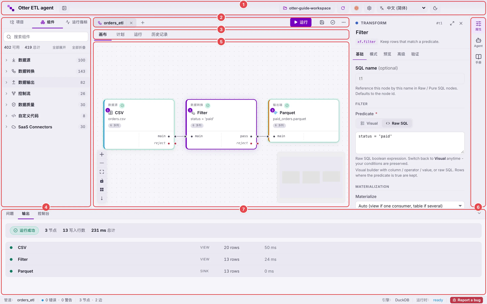
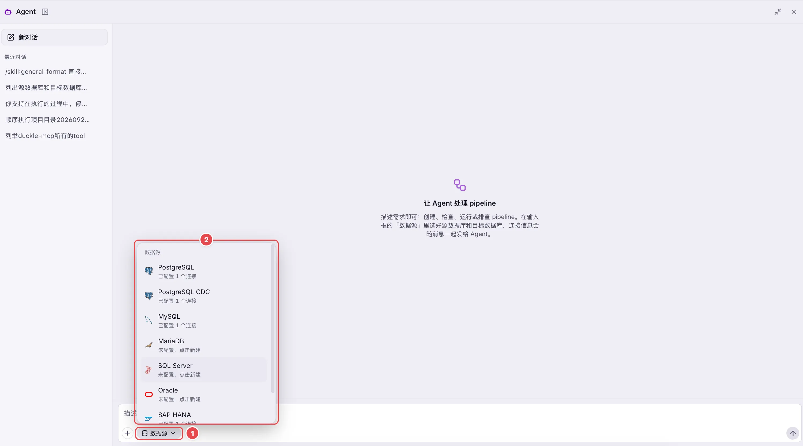
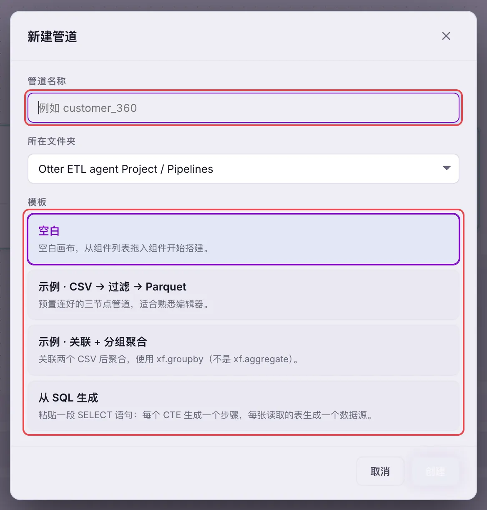
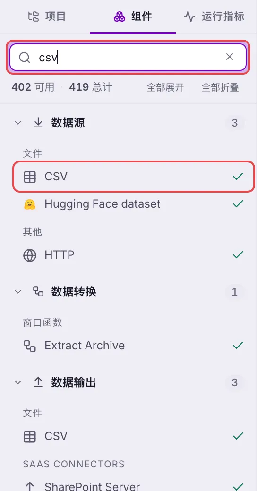
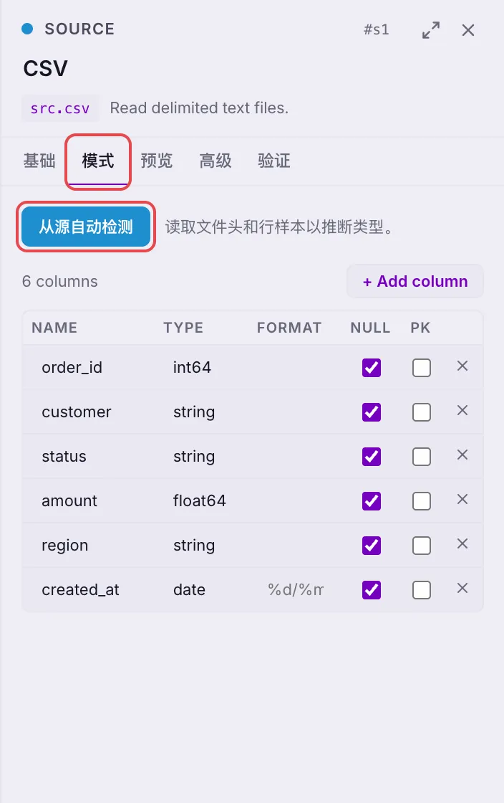
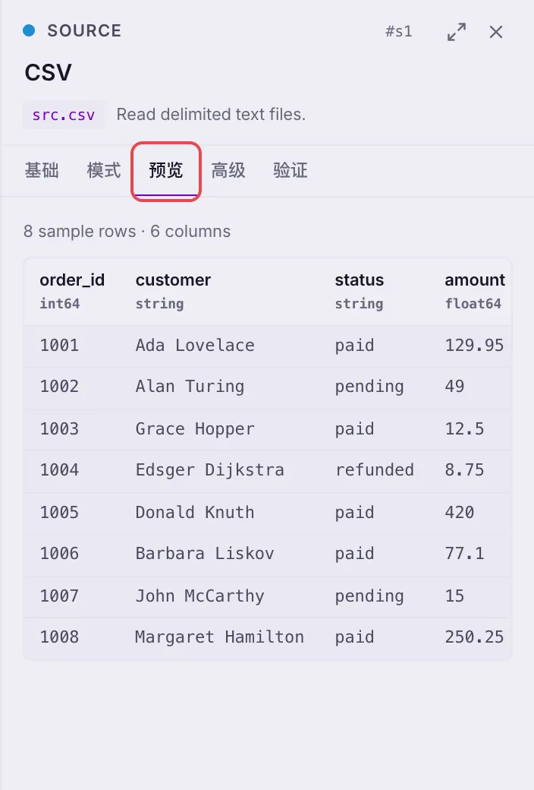
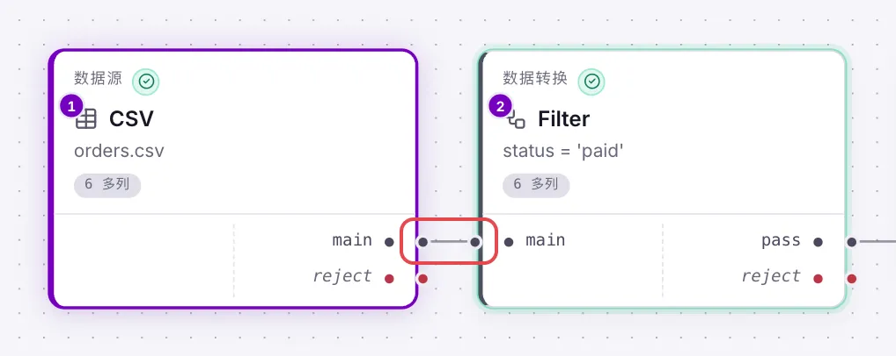
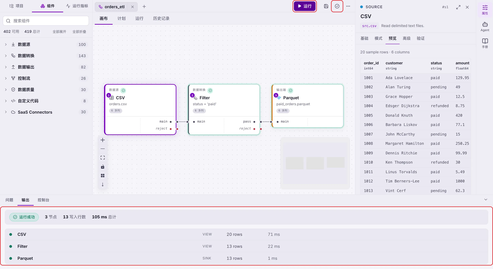
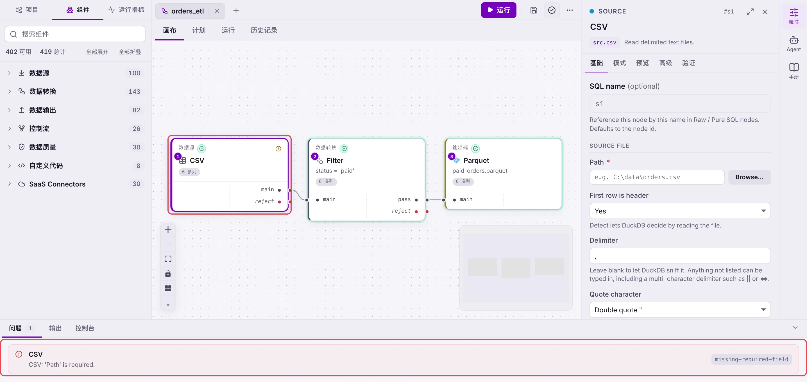
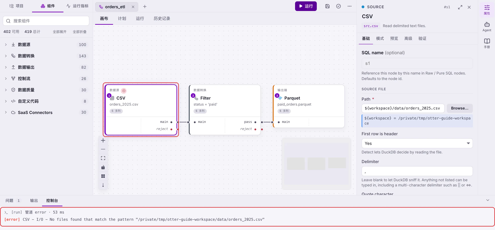

# Otter ETL agent 使用手册

> 本手册随应用一起打包发布。遇到问题时，可以先看 [排错指南](#4-排错指南)。

## 1. 这是什么工具

**Otter ETL agent** 是一款运行在本机的数据集成（ETL）桌面工具，用来把数据从一个地方**读出来、加工好、再写到另一个地方**，例如：

- 把旧系统数据库里的订单表迁移到新系统，并在迁移过程中做字段映射、清洗和校验；
- 把多个 CSV / Excel / Parquet 文件合并、汇总后写入数据库；
- 定期从数据库抽取数据，生成报表文件。

完成一次这样的数据处理任务的流程，叫做一个 **Pipeline（管道）**。Pipeline 由若干**节点**和连接节点的**连线**组成：

```
数据源（读取） → 数据转换（加工） → 数据输出（写入）
```

它有两种搭建方式：

| 方式 | 适合谁 | 说明 |
|---|---|---|
| **Agent 智能搭建** | 想快速出结果、不熟悉组件的人 | 用中文描述需求，Agent 自动创建、校验、运行 Pipeline |
| **手动搭建** | 需要精细控制每一步的人 | 在画布上拖拽组件、连线、填写属性 |

两种方式产出的是同一种 Pipeline 文件，可以随时切换：先让 Agent 搭出初稿，再手动微调，是最常用的做法。

几个基本概念：

- **工作区**：本机上的一个普通文件夹，存放 Pipeline、数据连接、上下文变量和文档，全部是 JSON 文件，可以直接备份或纳入版本管理。
- **执行引擎**：Pipeline 最终会被编译成 SQL，由内置的 DuckDB 引擎在本机执行，数据不会上传到任何云服务。
- **数据连接**：保存好的数据库连接信息（地址、账号等），可在多个 Pipeline 中复用。密码加密保存在工作区内。

## 2. 主要功能

### 2.1 界面总览

| 区域 | 位置 | 作用 |
|---|---|---|
| 顶部栏 | 最上方 | 设置（齿轮图标）、界面语言、账号、亮色/暗色主题切换 |
| Pipeline 标签栏 | 顶部栏下方 | 已打开的 Pipeline 标签、**+** 新建、**运行**、保存、验证、更多操作（**…**） |
| 编辑器视图 | 标签栏下方 | **画布**（搭建）、**计划**（查看生成的 SQL）、**运行**（本次运行过程）、**历史记录**（历次运行） |
| 左侧边栏 | 左侧 | **项目**：工作区里的 Pipeline、连接、上下文等；**组件**：可拖到画布上的全部组件 |
| 画布 | 中间 | 放置节点、连线；左下角是缩放、自动布局和切换排列方向按钮，右下角是缩略图 |
| 右侧工具栏 | 最右侧 | **属性**（编辑选中节点）、**Agent**（智能助手）、**手册**（本手册） |
| 底部面板 | 最下方 | **问题**（校验结果）、**输出**（每个节点的行数和耗时）、**控制台**（执行日志） |



> 图中编号与上表一一对应：1 顶部栏、2 Pipeline 标签栏、3 编辑器视图、4 左侧边栏、5 画布、6 右侧工具栏、7 底部面板。

### 2.2 核心功能

- **数据源（读取）**：支持 CSV、Excel、JSON、Parquet 等文件；MySQL、PostgreSQL、SQL Server、Oracle、SQLite 等关系型数据库；以及云数据仓库、对象存储、REST API 等数百种来源。
- **数据转换（加工）**：过滤、派生列、类型转换、去重、排序、分组聚合、多表关联（Join）、合并（Union）、行列转换、窗口函数、字符串/日期处理等。其中**可视化映射器**可以不写 SQL 完成多表关联和字段映射。
- **数据质量**：非空、范围、正则、唯一性等校验；不通过的数据会从 **reject** 端口单独输出，方便核对。
- **数据输出（写入）**：写入文件或数据库，支持覆盖、追加、清空后写入（Truncate + insert）、按主键更新（Upsert）等写入模式。
- **控制流**：条件分流、并行执行、循环、调用其他 Pipeline、重试与异常捕获等。
- **自定义代码**：在节点中直接编写 SQL 或脚本，处理组件覆盖不到的逻辑。
- **Agent 智能助手**：用自然语言描述需求，自动生成、校验、运行、排查 Pipeline，详见 [3.1](#31-使用-agent-完成-pipeline)。
- **预览与 SQL 透明**：每个节点都可以预览样本数据；**计划**视图展示整条 Pipeline 编译出的 SQL，可在 **…** 菜单中复制或导出。
- **校验与运行记录**：编辑时实时检查必填项、悬空连线和循环；每次运行都会记录在**历史记录**中。
- **调度与部署**：在主页中可以为 Pipeline 设置定时调度（Schedules）、按顺序编排多个 Pipeline（Plans），或打包部署到服务器（Build and Deploy）。

## 3. 简易操作流程

### 准备工作

1. **选择工作区**：首次打开时选择一个文件夹作为工作区。已有工作区则选择原来的文件夹，之前的内容会自动加载。
2. **安装执行引擎**：首次使用会提示下载 DuckDB 引擎，按提示点击 **安装** 即可。
3. **准备数据**：确认能访问源数据库和目标数据库（网络、账号权限），或已准备好要处理的文件。

### 3.1 使用 Agent 完成 Pipeline

**第一步：配置模型（只需配置一次）**

1. 点击顶部栏的 **齿轮图标** 打开设置，展开 **AI assistant**。
2. 选择 **External OpenAI-compatible endpoint**，依次填写：
   - **Base URL**：模型服务地址，例如 `https://dashscope.aliyuncs.com/compatible-mode/v1`；
   - **Model**：模型名称，可点击 **Fetch models** 从服务端拉取后选择；
   - **API key**：模型服务的密钥。
3. 点击 **Save** 保存。

> 设置保存在当前工作区中，切换到新的工作区后需要重新配置。

**第二步：打开 Agent**

1. 点击右侧工具栏的 **Agent**（需要先打开工作区）。
2. 首次使用会提示 **安装 Agent**（下载约 75 MB 的运行环境），点击 **安装** 并等待完成。

**第三步：选择数据源**

1. 点击输入框下方的 **数据源** 按钮，选择数据库类型。
2. 选择已保存的连接，或点 **+ 新建连接** 填写地址、端口、库名、账号密码，点击 **测试连接** 确认能连通后点击 **保存并使用**。
3. 为连接选择用途：**源数据库**（Agent 从这里读取）、**目标数据库**（Agent 写入这里）或 **二者都是**。



> 连接信息会随消息发送给 Agent，但**密码不会发送给模型**。

**第四步：描述需求并发送**

在输入框中用中文把需求说清楚，例如：

```
把源库 sales.orders 表迁移到目标库 dw.ods_orders：
1. 只迁移 2024 年以后的订单；
2. 字段 cust_no 改名为 customer_id，金额保留两位小数；
3. order_id 重复的只保留最新一条；
4. 迁移完成后核对两边行数是否一致。
```

写好需求的小技巧：

- 写明**源表**和**目标表**的完整名称；
- 写明**筛选条件、字段映射、计算规则**；
- 写明**写入方式**（覆盖 / 追加 / 按主键更新）；
- 有现成的迁移说明文档时，可点击输入框旁的 **+** 作为附件添加（可执行文件不能作为附件）；
- 输入 `/` 可以调用工作区中预先编写的技能（Skill）。

**第五步：查看过程并打开结果**

1. Agent 会依次展示 **思考过程** 和 **执行进度**，例如 创建 pipeline → 校验 pipeline → 运行 pipeline。
2. 任务完成后，点击结果卡片上的 **打开**，生成的 Pipeline 会在画布中打开。
3. 在画布上检查节点和连线，点击节点在 **属性** 中查看配置，在 **预览** 中查看样本数据。
4. 结果不满意时，直接在对话中继续提要求，例如“目标表改成追加写入”，Agent 会在原 Pipeline 上修改。

> Agent 处理过程中可以随时点击 **停止**。如果提示输出被截断，发送“继续”即可让它接着完成。

### 3.2 手动完成 Pipeline

**第一步：新建 Pipeline**

点击标签栏的 **+**（或在左侧 **项目** 中右键 Pipelines → **New pipeline…**），输入名称并选择模板：

| 模板 | 说明 |
|---|---|
| Empty | 空白画布，从零开始 |
| Sample · CSV → Filter → Parquet | 预置的三节点示例，适合熟悉编辑器 |
| Sample · Join + Group By | 两个 CSV 关联后聚合的示例 |
| From SQL | 粘贴一段 SELECT 语句，自动拆成对应的节点 |



> Pipeline 名称会自动转换为小写英文字母、数字、下划线和短横线的组合，建议直接用英文命名。

**第二步：添加数据源**

1. 在左侧切换到 **组件**，展开 **数据源**，或在搜索框中输入关键字（如 `mysql`、`csv`）。
2. 把组件拖到画布上，点击该节点，在右侧 **属性 → 基础** 中填写：
   - 文件类：文件路径；
   - 数据库类：选择已保存的**连接**，再填写表名或查询 SQL。
3. 在 **模式** 页点击 **从源自动检测**，读取字段和类型；在 **预览** 页查看样本数据。





> 还没有保存的连接时，可以先在 Agent 输入框的 **数据源** 菜单中新建，新建后在这里就能选到。

**第三步：添加转换与校验**

1. 从 **数据转换** 中拖入需要的组件，例如过滤、聚合、关联。
2. **连线**：从上游节点右侧的输出端口拖到下游节点左侧的输入端口。
3. 选中节点，在 **属性** 中完成配置。多表关联或复杂映射可点击 **打开可视化映射器**。
4. 需要校验数据时，从 **数据质量** 中拖入校验组件；不通过的数据从 **reject** 端口输出，可再接一个输出节点保存下来核对。



**第四步：添加数据输出**

从 **数据输出** 中拖入目标组件，连接到最后一个转换节点，在属性中填写目标路径或目标表，并选择写入模式（覆盖 / 追加 / 清空后写入 / 按主键更新）。

**第五步：验证、运行、保存**

1. 点击标签栏的 **验证**（对勾图标），在底部 **问题** 中处理所有错误。
2. 点击 **运行**（快捷键 `F5`），节点会按执行顺序依次点亮并显示行数；运行中可点击 **停止**（`F6`）。
3. 在底部 **输出** 中查看每个节点的写入行数和耗时，在 **控制台** 中查看详细日志。
4. 点击 **保存**（`Ctrl+S`）。



> 小技巧：点击画布左下角的 **自动布局** 可以一键整理画布。

## 4. 排错指南

### 4.1 排错的基本思路

出现问题时，按下面的顺序定位：

1. **看节点状态**：出错的节点会标记为“失败”；配置不完整的节点会提示“缺失必填字段”。
2. **看底部面板**：
   - **问题**：配置层面的错误，例如必填项为空、连线悬空、存在循环；
   - **控制台**：运行时的详细错误信息，通常最后几行就是原因；
   - **输出**：每个节点的行数，可以看出数据在哪一步变少或变多。
3. **看数据**：选中节点，在 **属性 → 预览** 中查看该节点的样本数据，逐个节点往上游排查。
4. **看 SQL**：切换到 **计划** 视图查看生成的 SQL，可复制到数据库客户端中单独执行验证。
5. **问 Agent**：把错误信息发给 Agent，例如“运行 xxx 失败了，帮我排查”。Agent 可以读取运行日志、检查节点 SQL 并给出修改建议。




### 4.2 常见问题

**Pipeline 运行相关**

| 现象 | 可能原因 | 处理方法 |
|---|---|---|
| 节点提示“缺失必填字段” | 属性中有必填项未填写 | 点击节点，在 **属性 → 基础** 中补全必填字段 |
| 点击运行后提示找不到 DuckDB | 首次安装引擎被跳过或中断 | 重新打开应用，按提示安装 DuckDB 引擎 |
| 数据库连接失败或超时 | 地址、端口、账号错误，或网络不通 | 在 **数据源** 中编辑连接，点击 **测试连接** 确认；检查防火墙和 VPN |
| 提示登录被拒绝 | 密码错误或已过期 | 按弹窗提示重新输入账号密码，凭据只保存在本工作区 |
| 行数与预期不一致 | 过滤条件、关联条件或去重规则不对 | 在 **输出** 中找出行数变化的节点，用 **预览** 和 **计划** 核对条件 |
| 中文乱码 | 源文件编码不是 UTF-8 | 在文件数据源的属性中指定正确的编码 |
| 字段类型报错 | 自动推断的类型与实际数据不符 | 在 **模式** 页手动修改字段类型，或在上游加类型转换 |
| 企业网络下无法访问外部服务 | 需要通过代理上网 | 在 **设置 → HTTP / HTTPS proxy** 中配置代理 |

**Agent 相关**

| 现象 | 处理方法 |
|---|---|
| Agent 按钮是灰色的 | 先打开一个工作区 |
| 提示“未配置模型” | 按 [3.1 第一步](#31-使用-agent-完成-pipeline) 在设置中配置 External OpenAI-compatible endpoint |
| 提示 API Key 被拒绝 | 在 **设置 → AI assistant** 中检查 API key 是否正确、是否过期 |
| 提示额度已用完 | 充值或更换模型后，发送“继续” |
| 提示被限流 | 稍等片刻再发送 |
| 提示输出被截断 | 发送“继续”；任务很大时，先让 Agent 搭出可运行的骨架，再分步补充节点 |
| 提示运行环境不完整或进程意外退出 | 关闭 Agent 面板后重新打开，必要时重新安装 Agent |
| 生成的 Pipeline 不符合预期 | 在对话中补充更具体的要求，或打开后手动调整 |

### 4.3 仍然无法解决

请准备以下信息联系技术支持：

1. 问题现象的截图；
2. 底部 **控制台** 中的完整错误信息；
3. 出问题的 Pipeline（可通过 **…** → **导出为.duckle.json文件** 导出后一并提供）；
4. 操作步骤：做了什么、期望什么、实际发生了什么。
